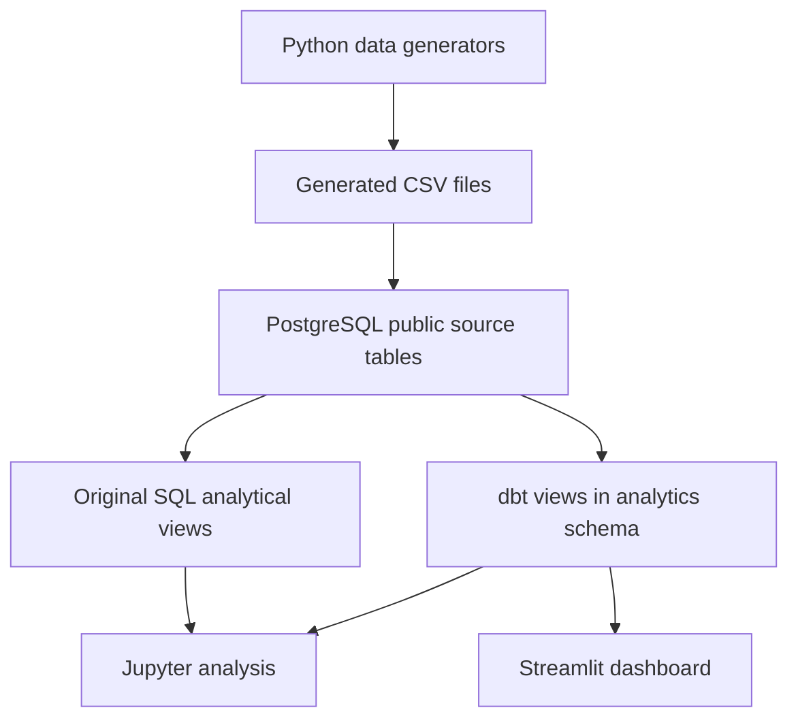

# Architecture

## Purpose

This project turns synthetic SaaS billing and prospect records into
tested analytical models and four dashboard pages: Revenue, Retention,
Collections, and Funnel.

The default reporting cutoff is October 1, 2026 at 00:00 UTC.

## Data flow

The source tables contain accounts, subscriptions, invoices,
payment attempts, and prospects.

Five staging views preserve source fields. Ten analytical views
calculate revenue, churn, retention, collections, and conversion metrics.
The dashboard reads the dbt views through read-only database connections.

The notebook uses original SQL analytical views and the dbt cohort
retention model.

## Local deployment

| Component | Location | Responsibility |
|---|---|---|
| Analytics database | Postgres.app on the Mac, port 5432 | Source tables and analytical views |
| Streamlit | Python environment on the Mac, port 8501 | Interactive dashboard |
| Airflow | Docker container; UI exposed locally on port 8081 | Schedule and execute workflow tasks |
| Airflow metadata database | Separate PostgreSQL 17 Docker container | Workflow state and execution history |
| dbt and dashboard test runtimes | Separate virtual environments inside the Airflow image | Execute builds, tests, and documentation generation |

Container tasks connect to the Mac's analytics database through
`host.docker.internal`.

The analytics database and Airflow metadata database serve different
purposes. Airflow metadata does not store the SaaS source records.

## Orchestration

The `saas_analytics_workflow` DAG executes:

1. `build_and_test_dbt`: build the dbt models and run data and unit tests.
2. `test_dashboard_pages`: run Streamlit integration checks.
3. `generate_dbt_documentation`: generate model documentation and lineage.

Each task requires its upstream task to succeed. Nonzero command exit
codes cause task failure rather than skipping.

The workflow uses:

- Daily scheduling at 08:00 America/Los_Angeles.
- Catchup disabled.
- At most one active DAG run.
- One retry per task after a one-minute delay.
- A ten-minute task timeout and thirty-minute DAG-run timeout.

A manual run of the completed workflow successfully executed all
three tasks on their first attempt.

Scheduled execution requires the Mac to be awake and Docker, Airflow,
and Postgres.app to be running.

## Storage and dependency isolation

The project is mounted read-only inside the Airflow container.
Docker named volumes retain Airflow metadata, state, logs, and dbt
artifacts.

Container-generated dbt artifacts are separate from the host's
`target/` directory.

Analysis, dbt, and dashboard dependencies are maintained separately.
The Airflow image also separates dbt and dashboard dependencies
into their own virtual environments.

## Continuous integration

| Workflow | Verification |
|---|---|
| Data pipeline CI | Regenerate CSV files, rebuild a fresh PostgreSQL 18 verification database, build dbt models, run data and unit tests, test dashboard pages, and generate documentation |
| Airflow validation CI | Validate Compose configuration, build the Docker image, and test DAG loading, task dependencies, and failure settings |

The current automated checks cover:

- 15 dbt view builds.
- 127 dbt data tests.
- Two dbt unit tests.
- Seven dashboard integration checks.
- Three Airflow DAG validation tests.

The Airflow validation tests run with container networking disabled.
Full workflow execution is verified separately through local Airflow.

## Scope

Airflow operates on the existing populated development database.
It does not regenerate or reload source CSV files, advance the reporting
cutoff, or ingest live customer events.

The dashboard is served locally. The repository does not include a
public production deployment.